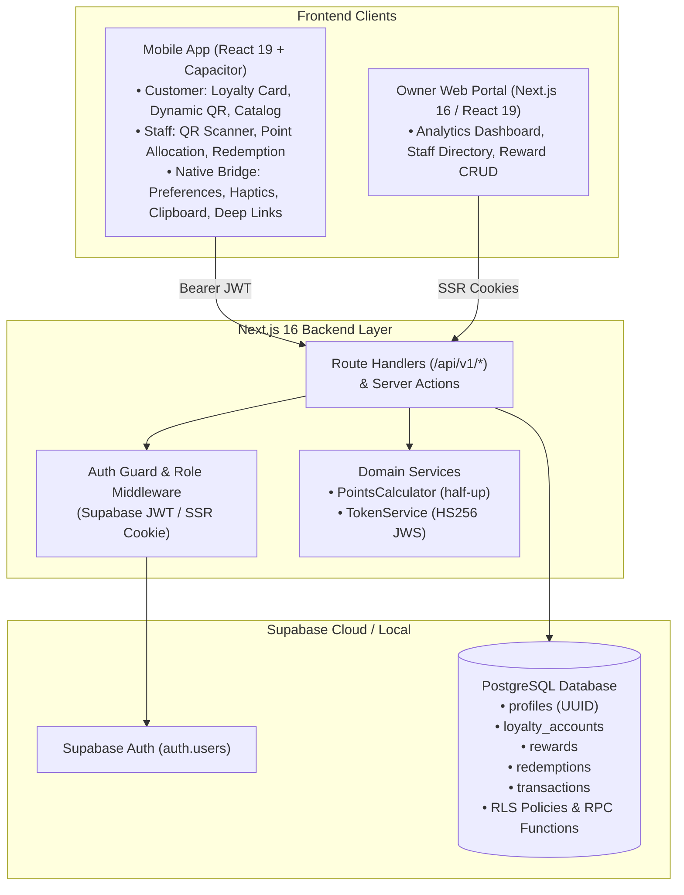

# BrewPoints — Combined Implementation Plan (Supabase + Next.js + React & Capacitor)

This document integrates the complete technical blueprint for the **BrewPoints** digital loyalty platform. It serves as the single source of truth across all implementation phases: Supabase PostgreSQL database foundation, Next.js REST API & Admin Portal, and the **React 19 + Capacitor** mobile client.

---

## Table of Contents
1. [Architecture & Stack Overview](#1-architecture--stack-overview)
2. [Database Schema & Supabase Configuration](#2-database-schema--supabase-configuration)
3. [Authentication & Authorization](#3-authentication--authorization)
4. [Phase 1: Backend Foundation & Points Allocation](#4-phase-1-backend-foundation--points-allocation)
5. [Phase 2: Reward Catalog & Atomic JWS Redemption Engine](#5-phase-2-reward-catalog--atomic-jws-redemption-engine)
6. [Phase 3: Mobile Application (React 19 & Capacitor)](#6-phase-3-mobile-application-react-19--capacitor)
7. [Phase 4: Admin Web Portal & Staff Management](#7-phase-4-admin-web-portal--staff-management)
8. [Testing & Out-of-Scope Items](#8-testing--out-of-scope-items)

---

## 1. Architecture & Stack Overview

| Layer | Component | Details |
|---|---|---|
| **Database** | **Supabase (PostgreSQL)** | Hosted/local PostgreSQL with Row Level Security (RLS), ACID transactions, and stored RPC functions |
| **Authentication** | **Supabase Auth** | Built-in `auth.users`, JWT verification, email OTP / Magic Links, and Google OAuth |
| **Backend API** | **Next.js 16 (App Router)** | REST API Route Handlers (`/api/v1/*`) with Bearer token authentication & `@supabase/ssr` / `@supabase/supabase-js` |
| **Web Admin Portal** | **Next.js 16 + React 19** | Owner analytics dashboard, staff CRUD, reward catalog manager (Tailwind CSS v4 + `shadcn/ui` + Recharts) |
| **Mobile Client** | **React 19 + Capacitor** | Native iOS & Android wrapper (`@capacitor/core`, `@capacitor/cli`, `@capacitor/preferences`, `@capacitor/haptics`, `@capacitor/clipboard`, `@capacitor/status-bar`, `@capacitor/app`) packaging the unified React Loyalty Wallet and Staff POS Scanner |



---

## 2. Database Schema & Supabase Configuration

### 2.1 Schema Tables

#### `profiles` (Extends `auth.users`)
Stores user identity and role assignment. Linked 1:1 to Supabase `auth.users.id`.
```sql
CREATE TABLE public.profiles (
    id UUID PRIMARY KEY REFERENCES auth.users(id) ON DELETE CASCADE,
    name VARCHAR(120) NOT NULL,
    email VARCHAR(190) UNIQUE NOT NULL,
    phone VARCHAR(32),
    role TEXT NOT NULL CHECK (role IN ('customer', 'staff', 'owner')) DEFAULT 'customer',
    deleted_at TIMESTAMPTZ,
    created_at TIMESTAMPTZ DEFAULT now(),
    updated_at TIMESTAMPTZ DEFAULT now()
);
```

#### `loyalty_accounts`
Stores current and lifetime point balances. 1:1 relationship with `profiles.id`.
```sql
CREATE TABLE public.loyalty_accounts (
    id BIGSERIAL PRIMARY KEY,
    user_id UUID UNIQUE NOT NULL REFERENCES public.profiles(id) ON DELETE CASCADE,
    current_points INT NOT NULL DEFAULT 0 CHECK (current_points >= 0),
    total_points_earned INT NOT NULL DEFAULT 0,
    total_points_redeemed INT NOT NULL DEFAULT 0,
    last_earned_at TIMESTAMPTZ,
    deleted_at TIMESTAMPTZ,
    created_at TIMESTAMPTZ DEFAULT now(),
    updated_at TIMESTAMPTZ DEFAULT now()
);
```

#### `rewards`
Reward catalog containing item name, point cost, and active status.
```sql
CREATE TABLE public.rewards (
    id BIGSERIAL PRIMARY KEY,
    name VARCHAR(120) NOT NULL,
    description VARCHAR(500),
    points_required INT NOT NULL CHECK (points_required > 0),
    active BOOLEAN NOT NULL DEFAULT true,
    deleted_at TIMESTAMPTZ,
    created_at TIMESTAMPTZ DEFAULT now(),
    updated_at TIMESTAMPTZ DEFAULT now()
);
```

#### `redemptions`
Immutable audit log of fulfilled reward redemptions. Uses a UUID v4 `jti` anti-replay key.
```sql
CREATE TABLE public.redemptions (
    id BIGSERIAL PRIMARY KEY,
    jti UUID UNIQUE NOT NULL,
    customer_id UUID NOT NULL REFERENCES public.profiles(id),
    reward_id BIGINT NOT NULL REFERENCES public.rewards(id),
    points_cost INT NOT NULL,
    confirmed_by_staff_id UUID NOT NULL REFERENCES public.profiles(id),
    confirmed_at TIMESTAMPTZ DEFAULT now(),
    created_at TIMESTAMPTZ DEFAULT now()
);
```

#### `transactions`
Append-only ledger of every point change.
```sql
CREATE TABLE public.transactions (
    id BIGSERIAL PRIMARY KEY,
    user_id UUID NOT NULL REFERENCES public.profiles(id),
    type TEXT NOT NULL CHECK (type IN ('earn', 'redeem', 'adjust')),
    points INT NOT NULL,
    amount NUMERIC(10, 2),
    staff_id UUID REFERENCES public.profiles(id),
    redemption_id BIGINT REFERENCES public.redemptions(id),
    note VARCHAR(500),
    created_at TIMESTAMPTZ DEFAULT now()
);
```

### 2.2 Row Level Security (RLS) & Atomic RPC Functions
1. **RLS Policies**:
   - `profiles`: Users can read their own profile; staff and owners can read all profiles.
   - `loyalty_accounts`: Customers can read their own balance; staff and owners can read all balances.
   - `rewards`: Authenticated users can view active rewards; owners can manage all rewards.
   - `transactions`: Customers can view their own transaction history; staff and owners can read all.
2. **Atomic Procedures**:
   - `allocate_points_atomic(p_customer_id, p_staff_id, p_amount, p_points, p_note)`: Executes `SELECT ... FOR UPDATE` on `loyalty_accounts`, updates points, and inserts `transactions` (`earn`).
   - `confirm_redemption_atomic(p_jti, p_customer_id, p_reward_id, p_staff_id)`: Checks JWS `jti` anti-replay key, locks `loyalty_accounts`, verifies balance, writes `redemptions`, deducts points, and logs `transactions` (`redeem`).

---

## 3. Authentication & Authorization

- **Supabase Auth Integration**:
  - Web users receive an encrypted `httpOnly` session cookie via `@supabase/ssr`.
  - Mobile apps receive access and refresh JWT tokens from `supabase.auth.signInWithPassword()` / OTP, passing `Authorization: Bearer <access_token>` on API calls.
- **Role Enforcement**:
  - Middleware & Route Handlers resolve the authenticated user's role from `profiles.role`.
  - `owner` role implicitly satisfies all role guards.

---

## 4. Phase 1: Backend Foundation & Points Allocation

### Endpoints
- `GET /api/v1/me`: Returns user profile (`id`, `name`, `email`, `phone`, `role`).
- `GET /api/v1/me/balance`: Returns `current_points`, `total_points_earned`, `total_points_redeemed`, `last_earned_at`.
- `GET /api/v1/me/transactions`: Paginated transaction history (20/page) with staff and reward metadata.
- `POST /api/v1/me/allocation-token`: Mints dynamic 10-minute JWS QR code (`brewpoints://allocate?token=...`).
- `POST /api/v1/points/allocate`: Staff/Owner allocates points based on purchase amount ($1.00 = 1 point, half-up rounding, $1.00–$1,000.00 bounds).

---

## 5. Phase 2: Reward Catalog & Atomic JWS Redemption Engine

### Reward Management (Owner Only)
- `GET /api/v1/rewards`: Lists active rewards (or all non-deleted rewards if `?include_inactive=1`).
- `POST /api/v1/rewards`: Creates new reward.
- `PATCH /api/v1/rewards/:id`: Updates reward details and toggles active status.
- `DELETE /api/v1/rewards/:id`: Soft-deletes reward (`deleted_at = now()`).

### Redemption Flow
1. **Minting**: Customer calls `POST /api/v1/redemptions` with `{ reward_id }`. System checks point balance and mints a 15-minute HS256 JWS QR payload: `brewpoints://redeem?token=<jws>` with unique `jti`.
2. **Scanner Preview**: Staff scans QR; `POST /api/v1/staff/scan-preview` decodes the payload and returns customer name, balance, and reward details.
3. **Atomic Confirmation**: Staff submits `POST /api/v1/staff/redemptions/confirm`. The system verifies signature and expiry, checks `jti` against `redemptions` (blocking replay attacks with `409 Conflict`), locks the account, deducts points, and issues a confirmation receipt.

---

## 6. Phase 3: Mobile Application (React 19 & Capacitor)

- **Capacitor Native Shell (`capacitor.config.ts` & `src/lib/capacitor/nativeBridge.ts`)**:
  - Packages the React 19 application into native iOS and Android shells (`com.brewpoints.app`).
  - `CapacitorAuthStorage`: Persists Supabase Auth JWTs natively via `@capacitor/preferences` (`localStorage` fallback on web).
  - Native device integration via `@capacitor/haptics` (tactile counter feedback), `@capacitor/clipboard`, `@capacitor/status-bar` (`#111110` Carbon Ink), and `@capacitor/app` (`brewpoints://` custom scheme deep-link handler).
- **Customer Screens (`/wallet`)**:
  - **Home / Loyalty Card**: Digital loyalty card with live variable-weight `Fraunces` point balance, milestone progress bar, future-spend simulator, and 10-minute dynamic allocation QR code (`qrcode.react`).
  - **Rewards Catalog**: Browse rewards, view point eligibility, and launch dynamic 15-minute redemption QR modal.
  - **History**: Paginated history of earned points and redeemed rewards.
- **Staff Screens (`/pos`)**:
  - **QR & Deep-Link Scanner**: Supports `brewpoints://allocate` and `brewpoints://redeem` via camera scan, native deep links, or clipboard paste.
  - **Allocation Form**: Customer name/balance preview, quick espresso bar presets (`$4.50`–`$42.00`), custom purchase amount input, live variable-weight points preview, and confirmation.
  - **Redemption Confirmation**: Fulfill reward, view customer balance, and confirm atomic deduction in <10s.

---

## 7. Phase 4: Admin Web Portal & Staff Management

- **Analytics Dashboard (`/dashboard`)**:
  - Live KPI cards: Total Points Issued, Points Redeemed, Active Customers, Redemption Rate.
  - Interactive charts: Point Velocity (Area), Reward Popularity (Bar), Staff Activity (Table), Redemption Growth (Line).
- **Staff Management (`/staff`)**:
  - Directory of barista staff accounts.
  - Create staff account, edit profile, and toggle active/inactive status.
- **Reward Catalog Manager (`/rewards`)**:
  - Visual grid of loyalty rewards with inline active/inactive toggles, edit dialogs, and deletion.

---

## 8. Testing & Out-of-Scope Items

### Testing Strategy
- Automated unit tests for half-up rounding in `PointsCalculator`.
- JWS token tampering, signature verification, and expiration tests in `TokenService`.
- Concurrency and anti-replay tests (`409 Conflict` on duplicate scan).
- Integration tests for all `/api/v1/*` Route Handlers.

### Out of Scope
- Multi-tenancy (designed strictly for a single independent coffee shop).
- Variable points or multi-tiered discount calculations.
- Transaction refunds and points rollbacks.
- Offline-first scanning (network connection required for live balance checks).
