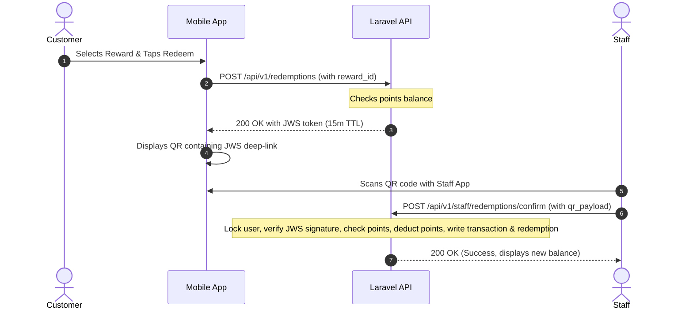

# BrewPoints — Combined Implementation Plan

This document integrates the plans for all four phases of the BrewPoints loyalty program implementation. It serves as the single source of truth for backend foundation, redemption business logic, mobile application development, and the admin dashboard.

---

## Table of Contents
1. [Core Requirements Overview](#core-requirements-overview)
2. [Phase 1: Backend Foundation (Laravel 12 + MySQL)](#phase-1-backend-foundation-laravel-12--mysql)
3. [Phase 2: Reward Management & Redemption API](#phase-2-reward-management--redemption-api)
4. [Phase 3: Mobile App (React Native & Expo)](#phase-3-mobile-app-react-native--expo)
5. [Phase 4: Admin Dashboard (Next.js)](#phase-4-admin-dashboard-nextjs)
6. [Out of Scope & Deferred Features](#out-of-scope--deferred-features)

---

## Core Requirements Overview

- **Tenancy**: Single-tenant, designed for a single coffee shop.
- **Points System**: Points earned based on spend. Staff manually enters the purchase total to allocate points.
- **Rewards**: Fixed point cost for each reward item (e.g., 100 points = Free Espresso).
- **Authentication**: Firebase Authentication for verification and OTP.
- **Authorization**: Roles (`customer`, `staff`, `owner`) stored in the local MySQL database.
- **Security**: Dynamic JWS tokens in QR codes to prevent screenshot reuse and fraud.
- **Redemption**: Customer claims reward in-app $\rightarrow$ presents QR to staff $\rightarrow$ staff confirms scan $\rightarrow$ points deducted atomically.

---

## Phase 1: Backend Foundation (Laravel 12 + MySQL)

**Goal:** Establish the Laravel 12 + MySQL backend foundation, including core database schema, Firebase authentication verification middleware, role-based authorization, and basic profile endpoints.

### 1. Stack & Layout

| Item | Choice |
|---|---|
| Framework | Laravel 12.x (PHP 8.3+) |
| Install Method | `composer create-project laravel/laravel .` at repo root |
| Web Server | XAMPP Apache (PHP bundled) |
| Database | XAMPP MariaDB 10.x, `localhost:3306` |
| DB Name | `brewpoints` |
| DB User | `root` |
| DB Password | (empty) |
| API Prefix | `/api/v1` |
| Auth Provider | Firebase Authentication |
| Role Storage | MySQL `users.role` (not Firebase custom claims) |

> [!NOTE]
> Existing repository files (`REQUIREMENTS.md`, `client.md`, etc.) are moved into `docs/` so Laravel can be initialized directly at the repository root.

### 2. Database Schema (Phase 1)

Three tables are created in Phase 1. The `transactions` and `redemptions` tables are deferred to Phase 2.

#### 2.1 `users`

| Column | Type | Notes |
|---|---|---|
| `id` | BIGINT UNSIGNED PK | auto-increment |
| `name` | VARCHAR(120) | required |
| `email` | VARCHAR(190) UNIQUE | primary identifier |
| `phone` | VARCHAR(32) NULL | optional |
| `firebase_uid` | VARCHAR(128) UNIQUE | auth key, never null |
| `role` | ENUM('customer','staff','owner') | default `'customer'` |
| `deleted_at` | TIMESTAMP NULL | soft deletes |
| `created_at`, `updated_at` | TIMESTAMP | |

#### 2.2 `loyalty_accounts`

One loyalty account per user, 1:1 via UNIQUE foreign key.

| Column | Type | Notes |
|---|---|---|
| `id` | BIGINT UNSIGNED PK | auto-increment |
| `user_id` | BIGINT UNSIGNED UNIQUE FK → `users.id` | ON DELETE CASCADE |
| `current_points` | INT UNSIGNED | default `0` |
| `total_points_earned` | INT UNSIGNED | default `0` |
| `total_points_redeemed` | INT UNSIGNED | default `0` |
| `last_earned_at` | TIMESTAMP NULL | updated on every allocation |
| `deleted_at` | TIMESTAMP NULL | soft deletes |
| `created_at`, `updated_at` | TIMESTAMP | |

#### 2.3 `rewards`

Created in Phase 1, but no endpoints ship until Phase 4 (and listing endpoints in Phase 2). Seeded with 2 demo rows.

| Column | Type | Notes |
|---|---|---|
| `id` | BIGINT UNSIGNED PK | auto-increment |
| `name` | VARCHAR(120) | required |
| `description` | VARCHAR(500) NULL | |
| `points_required` | INT UNSIGNED | required |
| `active` | BOOLEAN | default `true` |
| `deleted_at` | TIMESTAMP NULL | soft deletes |
| `created_at`, `updated_at` | TIMESTAMP | |

### 3. Authentication & Authorization

#### 3.1 Firebase ID Token Verification
- Every request to `/api/v1/*` must carry an `Authorization: Bearer <firebase_id_token>` header.
- Middleware verifies the JWT signature against Google's JWKS (cached in memory), checks `iss`, `aud` (Firebase Project ID), and `exp`.
- On success, the token's `sub` claim (Firebase UID) is used to find the matching row in the `users` table.
- If the user is missing, the request is rejected with `401 Unauthorized`.
- A `FirebaseTokenFake` helper is introduced to bypass JWKS for local and automated testing.

#### 3.2 Role Middleware
- A reusable custom middleware `role:staff|owner` reads the resolved user's `role` column. Applied to staff-only endpoints. Owners implicitly pass all role checks.

#### 3.3 Auth Errors
- **401 Unauthorized**: Missing, malformed, or expired token, or Firebase UID not found in the `users` table.
- **403 Forbidden**: Valid token, but the user's role does not match the endpoint requirement.

### 4. Business Rules — Points

All knobs live in `config/loyalty.php`, overridable via `.env`.

#### 4.1 Configuration Keys (`config/loyalty.php`)

| Key | Example Value | Purpose |
|---|---|---|
| `points_per_currency_unit` | `1` | Points awarded per 1.00 of purchase |
| `min_spend_amount` | `1.00` | Reject allocations below this |
| `max_spend_amount` | `1000.00` | Reject allocations above this |

#### 4.2 Points Calculation
- Purchase amount is received as `DECIMAL(10,2)`.
- Calculated via:
  $$points = \text{round}(amount \times points\_per\_currency\_unit, 0, \text{PHP\_ROUND\_HALF\_UP})$$
- The resulting integer is added to `loyalty_accounts.current_points` and `total_points_earned`.
- `last_earned_at` is set to `now()`.

#### 4.3 Validation Outcomes

| Condition | Response |
|---|---|
| `amount` missing or non-numeric | `422 Unprocessable Content` |
| `amount` < `min_spend_amount` | `422 Unprocessable Content` |
| `amount` > `max_spend_amount` | `422 Unprocessable Content` |
| `customer_firebase_uid` not in `users` | `404 Not Found` |
| Customer `users.deleted_at` is set | `409 Conflict` (inactive customer) |
| Happy path | `200 OK` with updated balance |

### 5. API Surface (Phase 1)

All endpoints under `/api/v1` require a valid Firebase bearer token.

#### 5.1 `GET /me`
Returns caller profile and role.
```json
{
  "data": {
    "id": 7,
    "name": "Jane Owner",
    "email": "owner@brewpoints.local",
    "phone": null,
    "role": "owner"
  }
}
```

#### 5.2 `GET /me/balance`
Returns the caller's loyalty balance.
```json
{
  "data": {
    "current_points": 0,
    "total_points_earned": 0,
    "total_points_redeemed": 0,
    "last_earned_at": null
  }
}
```

#### 5.3 `GET /me/transactions`
Returns an empty list in Phase 1 (the table is added in Phase 2).
```json
{ "data": [] }
```

#### 5.4 `POST /points/allocate` (Staff/Owner only)
Request:
```json
{
  "customer_firebase_uid": "AbC123...",
  "amount": "12.50"
}
```
Success Response (200 OK):
```json
{
  "data": {
    "customer_id": 42,
    "points_credited": 13,
    "new_balance": 13,
    "total_earned": 13
  }
}
```

#### 5.5 Error Envelope (All endpoints)
```json
{
  "message": "The amount must be at least 1.00.",
  "errors": {
    "amount": ["The amount must be at least 1.00."]
  }
}
```

### 6. Provisioning — Owner & Staff Seeder

A database seeder inserts two accounts on `php artisan db:seed`:
- `owner@brewpoints.local` (`owner`) $\rightarrow$ Firebase UID from `.env` `SEED_OWNER_FIREBASE_UID`.
- `staff@brewpoints.local` (`staff`) $\rightarrow$ Firebase UID from `.env` `SEED_STAFF_FIREBASE_UID`.

Each receives a corresponding `loyalty_accounts` record. The seeder is idempotent (upserts on `email`).

### 7. Testing Posture
- `FirebaseTokenFake` helper simulates signed Firebase ID tokens.
- No unit tests, full HTTP test coverage, or CI configuration in Phase 1. One happy-path test exercising `POST /points/allocate` is written.

### 8. Repository Conventions
- Git: Not initialized by the agent automatically.
- Commits: Conventional Commits (`feat:`, `chore:`, `test:`, `docs:`, `fix:`).
- `.gitignore`: Default Laravel template + `.env`, storage keys, and build assets.

### 9. Documentation Deliverables
- `README.md`: Project summary, setup instructions (composer, environment, database migration), and run commands.
- `CONTRIBUTING.md`: Branching model, conventional commits guide, and styling rules.

### 10. Build Order
1. Move pre-existing repository documentation files into `docs/`.
2. Initialize Laravel 12 project at root: `composer create-project laravel/laravel .`.
3. Configure `.env` with DB, Firebase, and seed credentials.
4. Run migrations: `users` $\rightarrow$ `loyalty_accounts` $\rightarrow$ `rewards`.
5. Create Eloquent models with `SoftDeletes` and relationships.
6. Create `FirebaseTokenVerifier` service and `AuthenticateFirebase` middleware.
7. Create `RequireRole` middleware.
8. Create `PointsCalculator` value object.
9. Implement controllers and form requests for the Phase 1 endpoints.
10. Wire up routes in `routes/api.php` under the `/v1` prefix.
11. Build the Owner/Staff seeder.
12. Add `FirebaseTokenFake` helper and one happy-path HTTP test.
13. Write `README.md` and `CONTRIBUTING.md`.

---

## Phase 2: Reward Management & Redemption API

**Goal:** Implement the Reward Management API, the append-only transactions ledger, and the secure, atomic Reward Redemption flow.

### 1. Data Model Extensions

Two new core tables are introduced.

#### 1.1 `redemptions`
An immutable log of confirmed reward claims.

| Column | Type | Notes |
|---|---|---|
| `id` | BIGINT UNSIGNED PK | auto-increment |
| `jti` | CHAR(36) UNIQUE NOT NULL | The unique ID from the JWS token (UUID v4) |
| `customer_id` | BIGINT UNSIGNED FK → `users.id` | The redeemer |
| `reward_id` | BIGINT UNSIGNED FK → `rewards.id` | The reward claimed |
| `points_cost` | INT UNSIGNED | Snapshotted current `points_required` at confirm-time |
| `confirmed_by_staff_id` | BIGINT UNSIGNED FK → `users.id` | The staff member who verified the QR |
| `confirmed_at` | TIMESTAMP | Time of confirmation |
| `created_at`, `updated_at` | TIMESTAMP | |

> [!IMPORTANT]
> No soft deletes on the `redemptions` table. Once confirmed, redemptions are permanent ledger entries.

#### 1.2 `transactions`
The append-only financial ledger for all points movements.

| Column | Type | Notes |
|---|---|---|
| `id` | BIGINT UNSIGNED PK | auto-increment |
| `user_id` | BIGINT UNSIGNED FK → `users.id` | Whose balance changed |
| `type` | ENUM('earn','redeem','adjust') | Type of movement |
| `points` | INT UNSIGNED | Number of points involved |
| `amount` | DECIMAL(10,2) NULL | The purchase total (only for `earn` types) |
| `staff_id` | BIGINT UNSIGNED FK → `users.id` NULL | Staff who triggered the action |
| `redemption_id` | BIGINT UNSIGNED FK → `redemptions.id` NULL | Link to the redemption row (only for `redeem`) |
| `note` | VARCHAR(500) NULL | For manual adjustments or audit notes |
| `created_at`, `updated_at` | TIMESTAMP | |

### 2. Reward Management (Admin API)

Allows the Owner to manage the catalog of available rewards.

#### 2.1 Endpoints

| Method | Endpoint | Auth | Action |
|---|---|---|---|
| `GET` | `/api/v1/rewards` | Authed | Returns only `active=true` and non-deleted rewards. |
| `POST` | `/api/v1/rewards` | `role:owner` | Create a new reward. |
| `PATCH` | `/api/v1/rewards/{id}` | `role:owner` | Partially update reward details. |
| `DELETE` | `/api/v1/rewards/{id}` | `role:owner` | Soft-delete reward (`deleted_at`). |

#### 2.2 Validation & Semantics
- **Naming**: `name` must be unique among rewards that are not soft-deleted.
- **Cost Guard**: `points_required` must be between 1 and `config('loyalty.max_reward_cost')`.
- **Active Flag**: `active` boolean allows pausing a reward without deleting it.

### 3. Redemption Flow

A customer claims a reward using a secure JWS token represented as a dynamic QR code.



#### 3.1 Minting the Token (`POST /api/v1/redemptions`)
1. **Auth**: Requires a valid bearer token (Customer, Staff, or Owner).
2. **Validation**:
   - Verify `reward_id` exists, is `active=true`, and is not soft-deleted.
   - Check if `customer.current_points >= reward.points_required`. Return `422` if insufficient.
3. **Token Generation**:
   - Mint a **JWS HS256** compact token.
   - **Claims**: `{ "customer_id": X, "reward_id": Y, "jti": "<uuid-v4>", "iat": <now>, "exp": <now + 15m> }`.
   - Secret key stored in `.env`.
4. **Response**:
   - Returns the token as a deep-link URL: `brewpoints://redeem?token=<jws>`.
   - Includes current balance and reward details.

#### 3.2 Confirming the Token (`POST /api/v1/staff/redemptions/confirm`)
1. **Auth**: Requires `role:staff|owner` bearer token.
2. **Payload**: `{ "qr_payload": "brewpoints://redeem?token=..." }`.
3. **Process (Atomic Transaction)**:
   - **Extract & Verify**: Parse URL and verify JWS signature + expiration (`exp`).
   - **Lock**: `SELECT ... FOR UPDATE` on the customer's `loyalty_accounts` row.
   - **Verify**: Check that the reward is still active/not deleted and the customer still has enough points.
   - **Commit**:
     - Insert a row into `redemptions`. Reject with `409 Conflict` if the `jti` already exists (anti-replay check).
     - Deduct `points_required` from `loyalty_accounts.current_points`.
     - Increment `loyalty_accounts.total_points_redeemed`.
     - Insert a row into `transactions` (type: `redeem`).
4. **Response**: Returns the updated balance.
5. **Errors**: `401` (bad token), `410 Gone` (expired JWS), `409 Conflict` (already redeemed / replay / user inactive), `422` (insufficient points).

### 4. API Enhancements

#### 4.1 Transaction History (`GET /api/v1/me/transactions`)
- Queries the `transactions` table.
- Returns paginated results ordered by `created_at DESC` for the authenticated caller.

#### 4.2 Throttling
- Apply `throttle:10,1` (10 requests per minute) to:
  - `POST /api/v1/redemptions` (Prevent token spam)
  - `POST /api/v1/points/allocate` (Prevent allocation spam)

#### 4.3 Phase 1 Backport
- Upgrade `POST /api/v1/points/allocate` to write a `transactions` row (type: `earn`) in the same database transaction as the balance update.

### 5. Build Order
1. **Migrations**: Create `transactions` and `redemptions` tables.
2. **Models**: Add relationships `transactions()` and `redemptions()` to `User` and `LoyaltyAccount`.
3. **Config**: Add `max_reward_cost` and `redemption_token_ttl` variables to `config/loyalty.php`.
4. **Reward CRUD**: Implement Owner endpoints for managing rewards.
5. **Redemption Minting**: Build the JWS token creation endpoint.
6. **Redemption Confirmation**: Build the staff confirmation endpoint with row locking.
7. **Audit Log**: Implement `GET /api/v1/me/transactions`.
8. **Hardening**: Add route throttling and upgrade the allocation endpoint to use transactions.
9. **Verification**: Verify CRUD, token lifecycle, replay protection, and error handling via integration tests.

---

## Phase 3: Mobile App (React Native & Expo)

**Goal:** Develop the cross-role mobile application using React Native (Expo) supporting both Customer and Staff dashboards, dynamic QR generation, scanner integration, and transaction history.

### 1. Architecture & Tech Stack
- **Framework**: React Native with Expo (Managed Workflow).
- **State Management**: Context API or Zustand.
- **Authentication**: Firebase SDK (Phone/OTP and Email/Password).
- **Navigation**: React Navigation (Stack and Tab layouts).
- **Scanner/QR**: `expo-barcode-scanner` for staff; `react-native-qrcode-svg` for customers.

### 2. Authentication & Onboarding
- **Sign In/Up**: Register or log in via Email/Password or Phone/OTP.
- **Role Discovery**: After signing in, the app calls `GET /api/v1/me` to retrieve the database-stored role (`customer`, `staff`, `owner`).
- **UI Routing**: Dynamically mount either the **Customer Dashboard** or the **Staff Dashboard** based on this role.

### 3. Customer Interface

#### 3.1 Point Allocation QR
- **QR Generation**: Generates a JWS token signed by the backend with a **10-minute TTL**.
- **Auto-Refresh**: Re-generates the token/QR periodically to prevent reuse of screenshot images.
- **Payload**: `brewpoints://allocate?token=<jws>`.

#### 3.2 Reward Catalog & Redemption
- **Catalog**: Scrollable list of active rewards fetched from `/api/v1/rewards`.
- **Detail View**: Displays reward description, points required, and customer's current progress.
- **Redeem Action**: Tapping "Redeem" confirms points will be deducted on scan, calls `POST /api/v1/redemptions` to mint a token, and displays the redemption QR code (`brewpoints://redeem?token=<jws>`).

#### 3.3 Engagement & History
- **Milestone Indicator**: Visual progress bar showing how close the user is to earning the cheapest reward they cannot currently afford.
- **History List**: Paginated log of previous point gains/spendings and a "Rewards Summary" detailing total claimed value.

### 4. Staff Interface

#### 4.1 Unified Scanner
- Launching the camera scanner reads incoming QR payloads:
  - If payload matches `brewpoints://allocate` $\rightarrow$ Redirects to **Allocation Flow**.
  - If payload matches `brewpoints://redeem` $\rightarrow$ Redirects to **Redemption Flow**.

#### 4.2 Allocation Flow
1. **Scan**: Scan the customer's point allocation QR.
2. **Identity**: Fetch and show the customer's name and current point balance.
3. **Amount Entry**: Staff enters the checkout total (USD).
4. **Summary**: Staff confirms the details (e.g., "$15.00 spend matches 15 points").
5. **Submit**: Call `POST /api/v1/points/allocate` to apply points.

#### 4.3 Redemption Flow
1. **Scan**: Scan the customer's redemption QR.
2. **Verify**: Display a screen showing:
   - Customer Name.
   - Reward Name.
   - Points Cost.
   - Customer Balance.
3. **Confirm**: Tap "Confirm" to submit `POST /api/v1/staff/redemptions/confirm`, finalizing the redemption.

### 5. Resilience & Edge Cases
- **Fail-Fast Connectivity**: If the backend is offline, show a prominent "Connection Error" screen. Do not queue transactions offline to prevent points manipulation/double-spending.
- **Session Expiry**: Handle expired Firebase tokens by clearing local state and returning the user to the login screen.

---

## Phase 4: Admin Dashboard (Next.js)

**Goal:** Create a privileged Owner-only Next.js web application for staff account management, reward catalog administration, and overall loyalty program analytics.

### 1. Architecture & Access Control
- **Framework**: Next.js.
- **Authentication**: Firebase Web SDK.
- **Authorization**: Owner-only checks.
  - Page-level middleware validates that the user's local role is `owner`.
  - Non-owner users are redirected to a `/unauthorized` landing page.
  - Laravel backend checks `role:owner` for all admin API endpoints.

### 2. Staff Management Module
- **Staff Directory**: List of all database users with the `staff` role.
- **Account CRUD**:
  - **Create**: Register new staff members using email.
  - **Update**: Edit details (name, email, phone).
  - **Deactivate**: Soft-delete or toggle active status of staff accounts to immediately block API and app access.

### 3. Reward Catalog Manager
- **UI Layout**: Visual grid of card elements displaying rewards in a layout similar to the mobile view.
- **Actions**:
  - **Create / Edit**: Modal form to adjust name, description, points cost, and active status.
  - **Active Toggle**: Simple switch to pause/resume reward accessibility.
  - **Delete**: Soft-delete rewards to hide them from the catalog.

### 4. Program Health Dashboard (Analytics)
- **KPI Metrics**:
  - **Point Velocity**: Ratio/comparison of points issued vs. points redeemed (Liability tracking).
  - **Reward Popularity**: Horizontal bar chart of the most frequently claimed rewards.
  - **Staff Activity**: Table or chart showing points issued by staff member to detect anomalies or potential fraud.
  - **Redemption Growth**: Time-series chart tracking daily/weekly redemption activity.

### 5. Implementation Order
1. **Setup**: Initialize the Next.js app and configure Firebase Web SDK.
2. **Owner Guard**: Build authentication hooks and `/unauthorized` redirection.
3. **Staff CRUD**: Develop the staff administration screens.
4. **Reward CRUD**: Build the visual reward grid and modal managers.
5. **Analytics**: Implement charts and KPI panels.
6. **E2E verification**: Ensure permissions, real-time sync, and account deactivation function correctly.

---

## Out of Scope & Deferred Features

The following items are explicitly excluded from all phases of this initial implementation:
- **Multi-Tenant support**: No multi-branch or distinct company tenant settings.
- **Reward Tiers**: No tier leveling (e.g., Bronze, Silver, Gold benefits).
- **Partial/Variable Redemptions**: No option to redeem custom points for dollar discounts (points must be exchanged for discrete reward items).
- **Transaction Reversals**: No refund/points-reversal mechanisms are supported.
- **Offline Mode**: No offline transactional caching; the mobile app requires an active network connection.
- **Background Jobs**: No queue systems, email notifications, or delayed background processing.
- **Containerization & CI/CD**: Docker setups and automatic build/deployment configurations are out of scope.
- **Localization**: Single-language support (English).
