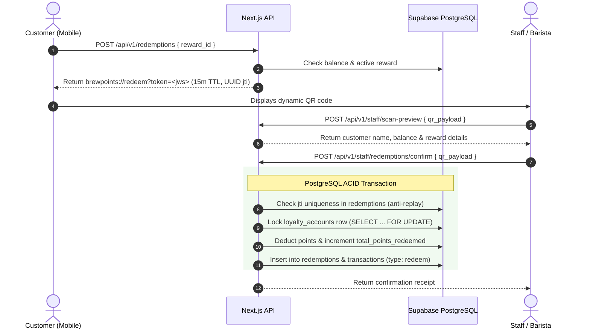

# BrewPoints — Phase 2 Plan (Reward Management & Atomic Redemption Engine)

**Phase 2 Goal:** Implement the reward catalog management endpoints, dynamic JWS token generation, and the atomic redemption confirmation workflow backed by Supabase PostgreSQL transactions.

---

## 1. Schema Extensions (Phase 2)

### 1.1 `redemptions` (Immutable Ledger)
Records fulfilled reward redemptions. Features a UUID v4 `jti` to block screenshot replay attacks.
```sql
CREATE TABLE public.redemptions (
    id BIGSERIAL PRIMARY KEY,
    jti UUID UNIQUE NOT NULL,
    customer_id UUID NOT NULL REFERENCES public.profiles(id),
    reward_id BIGINT NOT NULL REFERENCES public.rewards(id),
    points_cost INT NOT NULL,
    confirmed_by_staff_id UUID NOT NULL REFERENCES public.profiles(id),
    confirmed_at TIMESTAMPTZ DEFAULT now(),
    created_at TIMESTAMPTZ DEFAULT now()
);
```

### 1.2 `transactions` (Append-Only Audit Ledger)
Captures every point addition, deduction, or adjustment.
```sql
CREATE TABLE public.transactions (
    id BIGSERIAL PRIMARY KEY,
    user_id UUID NOT NULL REFERENCES public.profiles(id),
    type TEXT NOT NULL CHECK (type IN ('earn', 'redeem', 'adjust')),
    points INT NOT NULL,
    amount NUMERIC(10, 2),
    staff_id UUID REFERENCES public.profiles(id),
    redemption_id BIGINT REFERENCES public.redemptions(id),
    note VARCHAR(500),
    created_at TIMESTAMPTZ DEFAULT now()
);
```

---

## 2. Reward Management Endpoints (Owner Only)

- `GET /api/v1/rewards`: Returns active rewards (or all non-deleted rewards if `?include_inactive=1`).
- `POST /api/v1/rewards`: Creates a new reward (`name`, `description`, `points_required`, `active`). Validates unique name among active rewards.
- `PATCH /api/v1/rewards/:id`: Updates an existing reward.
- `DELETE /api/v1/rewards/:id`: Soft-deletes a reward (`deleted_at = now()`).

---

## 3. Dynamic QR Redemption Workflow



### 3.1 Step 1: Minting (`POST /api/v1/redemptions`)
- Customer selects a reward in the catalog.
- API verifies `current_points >= points_required` (`422` if insufficient).
- Generates a signed HS256 JWS token:
  - Claims: `{ type: 'redeem', customer_id, reward_id, jti: uuid_v4(), iat, exp: now + 900 }`
  - Payload returned: `brewpoints://redeem?token=<jws>` (15-minute validity).

### 3.2 Step 2: Staff Scan Preview (`POST /api/v1/staff/scan-preview`)
- Staff scans the customer's QR code.
- Decodes the token, checks signature and expiration (`410` if expired, `401` if invalid).
- Checks whether `jti` has already been redeemed (`409` if duplicate).
- Returns customer name, current balance, and reward info for staff verification.

### 3.3 Step 3: Atomic Confirmation (`POST /api/v1/staff/redemptions/confirm`)
- Staff clicks "Confirm Redemption".
- API runs a PostgreSQL transaction:
  1. `SELECT id, current_points FROM loyalty_accounts WHERE user_id = $1 FOR UPDATE`
  2. Ensures `jti` is not in `public.redemptions` (throws `409 Conflict` on replay).
  3. Ensures customer still has sufficient points (throws `422 Unprocessable`).
  4. Inserts row into `public.redemptions`.
  5. Updates `loyalty_accounts` balance.
  6. Inserts row into `public.transactions` (`type = 'redeem'`).
- Returns confirmation payload with new balance and reward name.
